![](data:image/svg+xml;base64,PHN2ZyB4bWxucz0iaHR0cDovL3d3dy53My5vcmcvMjAwMC9zdmciIHdpZHRoPSIyNSIgaGVpZ2h0PSIxOSIgdmlld2JveD0iMCAwIDI1IDE5Ij4KICAgICAgICAgICAgICAgICAgICA8ZyBpZD0iR3JvdXBfNTEzOSIgZGF0YS1uYW1lPSJHcm91cCA1MTM5IiB0cmFuc2Zvcm09InRyYW5zbGF0ZSgtMzI5IC02MCkiPgogICAgICAgICAgICAgICAgICAgICAgICA8bGluZSBpZD0iTGluZV8xIiBkYXRhLW5hbWU9IkxpbmUgMSIgeDI9IjIzIiB0cmFuc2Zvcm09InRyYW5zbGF0ZSgzMzAgNjEpIiBmaWxsPSJub25lIiBzdHJva2UtbGluZWNhcD0icm91bmQiIHN0cm9rZT0iI2ZmZiIgc3Ryb2tlLWxpbmVqb2luPSJyb3VuZCIgc3Ryb2tlLXdpZHRoPSIyIj4KICAgICAgICAgICAgICAgICAgICAgICAgPC9saW5lPgogICAgICAgICAgICAgICAgICAgICAgICA8bGluZSBpZD0iTGluZV8yIiBkYXRhLW5hbWU9IkxpbmUgMiIgeDI9IjIzIiB0cmFuc2Zvcm09InRyYW5zbGF0ZSgzMzAgNzApIiBmaWxsPSJub25lIiBzdHJva2UtbGluZWNhcD0icm91bmQiIHN0cm9rZT0iI2ZmZiIgc3Ryb2tlLWxpbmVqb2luPSJyb3VuZCIgc3Ryb2tlLXdpZHRoPSIyIj4KICAgICAgICAgICAgICAgICAgICAgICAgPC9saW5lPgogICAgICAgICAgICAgICAgICAgICAgICA8bGluZSBpZD0iTGluZV8zIiBkYXRhLW5hbWU9IkxpbmUgMyIgeDI9IjIzIiB0cmFuc2Zvcm09InRyYW5zbGF0ZSgzMzAgNzgpIiBmaWxsPSJub25lIiBzdHJva2UtbGluZWNhcD0icm91bmQiIHN0cm9rZS1saW5lam9pbj0icm91bmQiIHN0cm9rZT0iI2ZmZiIgc3Ryb2tlLXdpZHRoPSIyIj4KICAgICAgICAgICAgICAgICAgICAgICAgPC9saW5lPgogICAgICAgICAgICAgICAgICAgIDwvZz4KICAgICAgICAgICAgICAgIDwvc3ZnPg==)

- <a href="https://www.da.gov.kw/en/" class="text-uppercase">Home Page</a>

- <a href="https://www.da.gov.kw/en/news/" class="text-uppercase">News</a>

- 

  Contact Us
  

  

  

  ### Al Diwan Al Amiri

  -  [
    +9651888881 ](tel:+9651888881)
  - 
    

    Al Seif Al Amer Palace

    Kuwait City - Arabian Gulf Street - Al Seif Al Amer Palace

    

  - 
    

    Bayan Al-Amer Palace

    Postal address: Al Diwan Al Amiri - P.O. Box 1 - Postal Code 13001
    Safat Post - Kuwait

    

  

  

  

  

English

العربيّة

Français

- 
  <a href="https://www.da.gov.kw/en/biography/" id="dropdownId0"
  class="nav-link dropdown-toggle text-uppercase" aria-haspopup="true"
  aria-expanded="false">His highness the amir</a>
  

  <a href="https://www.da.gov.kw/en/biography/"
  class="dropdown-item">Biography</a>
  <a href="https://www.da.gov.kw/en/speeches/"
  class="dropdown-item">Speeches</a>

  

  
- 
  <a href="https://www.da.gov.kw/en/al-sabah-and-kuwait/" id="dropdownId1"
  class="nav-link dropdown-toggle text-uppercase" aria-haspopup="true"
  aria-expanded="false">Al-Sabah</a>
  

  <a href="https://www.da.gov.kw/en/al-sabah-and-kuwait/"
  class="dropdown-item">Al Sabah and Kuwait</a>
  <a href="https://www.da.gov.kw/en/the-rulers/" class="dropdown-item">The
  Rulers</a> <a href="https://www.da.gov.kw/en/al-sabah-family-tree/"
  class="dropdown-item">Al Sabah Family Tree</a>

  

  
- 
  <a href="https://www.da.gov.kw/en/historical-background/"
  id="dropdownId2" class="nav-link dropdown-toggle text-uppercase"
  aria-haspopup="true" aria-expanded="false">Al diwan al amiri</a>
  

  <a href="https://www.da.gov.kw/en/historical-background/"
  class="dropdown-item">About Al Diwan Al Amiri</a>
  <a href="https://www.da.gov.kw/en/minister-of-amiri-diwan-affairs/"
  class="dropdown-item">Minister of Al Diwan Al Amiri Affairs</a>

  

  
- 
- 
  <a href="https://www.da.gov.kw/en/diwan-amiri-entities/"
  class="nav-link text-uppercase">Entities affiliated to Al Diwan Al
  Amiri</a>
- 
  <a href="https://www.da.gov.kw/en/kuwait-history/" id="dropdownId1"
  class="nav-link dropdown-toggle text-uppercase" aria-haspopup="true"
  aria-expanded="false">About Kuwait</a>
  

  <a href="https://www.da.gov.kw/en/kuwait-history/"
  class="dropdown-item">Kuwait history</a>
  <a href="https://www.da.gov.kw/en/constitution/"
  class="dropdown-item">Constitution</a>
  <a href="https://www.da.gov.kw/en/facts-and-figures/"
  class="dropdown-item">Facts and Figures</a>
  <a href="https://www.da.gov.kw/en/kuwait-media-gallery/"
  class="dropdown-item">Media Gallery</a>

  

  
- 
  <a href="https://pnsd.da.gov.kw/ar/" id="dropdownId2"
  class="nav-link dropdown-toggle text-uppercase" aria-haspopup="true"
  aria-expanded="false">services</a>
  

  <a href="https://pnsd.da.gov.kw/ar/" class="dropdown-item"
  target="_blank">Tenders</a>
  <a href="https://pnsd.da.gov.kw/ar/" class="dropdown-item"
  target="_blank">Company Registration</a>
  <a href="https://debits.da.gov.kw/" class="dropdown-item"
  target="_blank">Electronic Payment Services</a>
  <a href="https://www.da.gov.kw/en/right-to-access/"
  class="dropdown-item">Right to Access</a>

  

  
- <a href="https://www.da.gov.kw/en/" class="nav-link text-uppercase">Home
  Page</a>
- <a href="https://www.da.gov.kw/en/news/"
  class="nav-link text-uppercase">News</a>
- Contact
  Us
  

  

  

  ### Al Diwan Al Amiri

  - 
    [+9651888881](tel:+9651888881)
  - 
    

    Al Seif Al Amer Palace

    Kuwait City - Arabian Gulf Street - Al Seif Al Amer Palace

    

  - 
    

    Bayan Al-Amer Palace

    Postal address: Al Diwan Al Amiri - P.O. Box 1 - Postal Code 13001
    Safat Post - Kuwait

    

  

  

  

  

- 
  <a href="https://www.da.gov.kw/en/" class="nav-link text-uppercase">Home
  Page</a>
- 
  <a href="https://www.da.gov.kw/en/news/"
  class="nav-link text-uppercase">News</a>
- 
  <a href="https://www.da.gov.kw/en/biography/" id="dropdownId2"
  class="nav-link dropdown-toggle text-uppercase" aria-haspopup="true"
  aria-expanded="false">His highness the amir</a>
  

  <a href="https://www.da.gov.kw/en/biography/"
  class="dropdown-item">Biography</a>
  <a href="https://www.da.gov.kw/en/speeches/"
  class="dropdown-item">Speeches</a>

  

  
- 
  <a href="https://www.da.gov.kw/en/al-sabah-and-kuwait/" id="dropdownId3"
  class="nav-link dropdown-toggle text-uppercase" aria-haspopup="true"
  aria-expanded="false">Al-Sabah</a>
  

  <a href="https://www.da.gov.kw/en/al-sabah-and-kuwait/"
  class="dropdown-item">Al Sabah and Kuwait</a>
  <a href="https://www.da.gov.kw/en/the-rulers/" class="dropdown-item">The
  Rulers</a> <a href="https://www.da.gov.kw/en/al-sabah-family-tree/"
  class="dropdown-item">Al Sabah Family Tree</a>

  

  
- 
  <a href="https://www.da.gov.kw/en/historical-background/"
  id="dropdownId4" class="nav-link dropdown-toggle text-uppercase"
  aria-haspopup="true" aria-expanded="false">Al diwan al amiri</a>
  

  <a href="https://www.da.gov.kw/en/historical-background/"
  class="dropdown-item">About Al Diwan Al Amiri</a>
  <a href="https://www.da.gov.kw/en/minister-of-amiri-diwan-affairs/"
  class="dropdown-item">Minister of Al Diwan Al Amiri Affairs</a>

  

  
- 
  <a href="https://www.da.gov.kw/en/kuwait-history/" id="dropdownId5"
  class="nav-link dropdown-toggle text-uppercase" aria-haspopup="true"
  aria-expanded="false">About Kuwait</a>
  

  <a href="https://www.da.gov.kw/en/kuwait-history/"
  class="dropdown-item">Kuwait history</a>
  <a href="https://www.da.gov.kw/en/constitution/"
  class="dropdown-item">Constitution</a>
  <a href="https://www.da.gov.kw/en/facts-and-figures/"
  class="dropdown-item">Facts and Figures</a>
  <a href="https://www.da.gov.kw/en/kuwait-media-gallery/"
  class="dropdown-item">Media Gallery</a>

  

  
- Contact
  Us
  

  

  

  ### Al Diwan Al Amiri

  - 
    [+9651888881](tel:+9651888881)
  - 
    

    Al Seif Al Amer Palace

    Kuwait City - Arabian Gulf Street - Al Seif Al Amer Palace

    

  - 
    

    Bayan Al-Amer Palace

    Postal address: Al Diwan Al Amiri - P.O. Box 1 - Postal Code 13001
    Safat Post - Kuwait

    

  

  

  

  
- 
  <a href="https://www.da.gov.kw/en/diwan-amiri-entities/"
  class="nav-link text-uppercase">Entities affiliated to Al Diwan Al
  Amiri</a>
- 
  <a href="https://pnsd.da.gov.kw/ar/" id="dropdownId8"
  class="nav-link dropdown-toggle text-uppercase" aria-haspopup="true"
  aria-expanded="false">services</a>
  

  <a href="https://pnsd.da.gov.kw/ar/" class="dropdown-item"
  target="_blank">Tenders Al-Diwan Al-Amiri</a>
  <a href="https://pnsd.da.gov.kw/ar/" class="dropdown-item"
  target="_blank">Company Registration</a>
  <a href="https://debits.da.gov.kw/" class="dropdown-item"
  target="_blank">Electronic Payment Services</a>
  <a href="https://www.da.gov.kw/en/right-to-access/"
  class="dropdown-item">Right to Access</a>

  

  

Amiri decree issued new law concerning foreigners' residency

 28-11-2024 \| 06:15 PM 

  Share 

Amiri decree 114/2024 concerning
the residency of foreigners was issued on Thursday containing 36
articles of seven chapters.\
The previous decree 17/1959 had been in effect for six decades and
required reforms to close the gaps in the law in addition to addressing
the concurrent legislative challenges.\
The first chapter of the residency dealt with the entry of foreigners
into Kuwait, indicating that foreigners must have in their possessing a
valid passport or document from the authorities of their country to
enter and leave the country.\
GCC citizens were exempted from needing a valid passport to enter and
leave Kuwait, saying that personal identification cards would suffice in
accordance with Kuwaiti Ministry of Interior regulations and agreements
with respective states.\
Foreigners must enter and leave Kuwait through ports specified by
Kuwait's Ministry, one of the articles of chapter one stressed.\
Chapter two of the law is concerned with notifying competent authorities
of foreigners born in Kuwait, saying that residents must provide the
passport or travel documentation to attain residency papers or a leave
deadline with the whole process given a period of four months from
birth.\
Chapter three is connected with rules and regulations of foreigners
residence, saying that residents, eager to reside in Kuwait, must obtain
residency permits from the Interior Ministry.\
One of the articles allowed Kuwaitis to request residency permits for
their non-Kuwait wives and husbands, children. In case of a Kuwaiti
women, the residency paper would not be given if they obtain citizenship
according to article eight of the Amiri Decree 15/1959 from their
previous marriage to a Kuwaiti citizen.\
Non-Kuwaiti women, previously married or widowed to Kuwaiti citizens,
have the right to ask for residency if they had children from a Kuwaiti
national.\
Foreigners who are in Kuwait on a visit visa must leave the country
within a period that did not exceed three months unless they have
obtained a residency permit from the Interior Ministry.\
Another article of the reformed law was on domestic workers and their
likes, which insisted that employers must notify the Interior Ministry
of helpers' absence within two weeks.\
Transferring residencies of domestic workers was also touched on. If a
helper left the country and stay over fourth months without prior
approval of the authorities, this residency permit would be annual by
the Interior Ministry.\
The chapter also included an article on regular foreign residency, which
did not exceed five years. A ten-year permit could be given to children
of Kuwaiti female nationals, real-estate owners, or categories assigned
by the Interior Ministry.\
Chapter four included penalties against residency trafficking and
related crimes, which the State of Kuwait strongly prohibits against and
set some harsh rules and regulations against such crimes.\
Chapter five contains provisions relating to the rules for the
deportation and eviction of foreigners, one of its articles empowers the
Minister of Interior to issue a deportation order of any foreigner even
if they hold a valid residence permit, in the cases provided for in the
articles of the Act.\
One of its articles states that a foreigner whose deportation order has
been issued can be detained for a period not exceeding 30 days, and is
renewable if such detention is necessary, since there are some who have
obstacles preventing them from leaving the country.\
Another article obliges the breadwinner or employer to bear the expenses
of deporting or removing a foreigner from Kuwait, and anyone who
employs, resides or harbors a foreigner to bear all the expenses of his
deportation or expulsion. Chapter six contains penalties for violating
this law One of its articles states that the Public Prosecution has
exclusive jurisdiction to investigate, act, and prosecute crimes
resulted from residence trafficking.\
An article of this chapter also stipulates the cases in which
reconciliation with the accused may be made if he violates some of the
provisions of this law or the regulations and decisions implementing and
the basis for reconciliation.\
Chapter seven is about General provisions.\
One of its articles specifies those who are excluded from this law,
heads of State and their families, heads and employees of diplomatic
missions and their families, on condition of reciprocity, holders of
diplomatic and political passports, on condition of reciprocity, and
those whom the Minister of Interior deems an exception with special
permission for considerations related to international courtesies.\
Article (34) stipulates that the regulations and executive decisions
issued under Amiri Decree No. 17 of 1959 shall continue to operate until
the necessary regulations and decisions are issued for its
implementation by the Minister of Interior within six months from the
date of its publication in the Official Gazette.\
Article (35) refers to the repeal of the aforementioned Amiri Decree No.
17 of 1959, and any provisions contrary to this law.\
Article (36) mandates the ministers, in their own capacity, to implement
this law and refer to its publication in the Official Gazette.

###  Related news

- 
  

  06-11-2026 \| 12:25 PM
  
  ##### 

  Kuwait Amir heads to US for routine medical checkup

  His Highness the Amir Sheikh Meshal Al-Ahmad Al-Jaber Al-Sabah headed
  to the US on Friday, to undergo the routine medical checkup.

  

- 
  

  05-11-2026 \| 06:58 PM
  
  ##### 

  Kuwait Amir to head to U.S. for routine medical checkups Friday

  His Highness the Amir Sheikh Meshal Al-Ahmad Al-Jaber Al-Sabah will
  leave for the friendly United States of America on Friday (November 6)
  to undergo routine medical checkups.

  

- 
  

  20-10-2026 \| 02:05 PM
  
  ##### 

  Kuwait Amir receives newly appointed senior judiciary officials

  His Highness the Amir Sheikh Meshal Al-Ahmad Al-Jaber Al-Sabah
  received Tuesday senior judicial officials who took the constitutional
  oath before His Highness on the occasion of assuming their new posts.\
  The officials were Supreme Council of the Judiciary President and
  Court of Cassation President First Counselor Hani Mohammad Al-Hamdan,
  Court of Cassation Vice President First Counselor Dhirar Abdullah
  Al-Waqyan, and Court of Appeal President First Counselor Tareq
  Abdulatif Al-Jaber.\
  Minister of Justice Nasser Yousef Al-Sumait attended the meeting.

  

- 
  

  19-10-2026 \| 01:15 PM
  
  ##### 

  Kuwait Amir hosts luncheon in honor of French Pres.

  His Highness the Amir Sheikh Meshal Al-Ahmad Al-Jaber Al-Sabah hosted
  a luncheon at Bayan Palace on Monday in honor of French President
  Emmanuel Macron and his accompanying delegation during their official
  visit to Kuwait.

  

- 
  

  19-10-2026 \| 12:39 PM
  
  ##### 

  Kuwait Amir, French Pres. exchange highest national decorations

  His Highness the Amir Sheikh Meshal Al-Ahmad Al-Jaber Al-Sabah awarded
  visiting French President Emmanuel Macron Order of Mubarak Al-Kabeer
  at Bayan Palace on Monday, in recognition of the Kuwaiti people's
  appreciation and to strengthen friendly ties between the two
  countries.\
  In return, President Macron awarded His Highness the Amir the Grand
  Cross of the Legion of Honor, France's highest national order, in
  recognition of His Highness's role in expanding cooperation and
  strengthening bilateral relations across all fields.

  

- 
  

  19-10-2026 \| 12:30 PM
  
  ##### 

  Kuwait Amir, French Pres. chair official talks

  Official talks between Kuwait and France were held at Bayan Palace on
  Monday, chaired by His Highness the Amir Sheikh Meshal Al-Ahmad
  Al-Jaber Al-Sabah and French President Emmanuel Macron.\
  His Highness the Crown Prince Sheikh Sabah Khaled Al-Hamad Al-Sabah,
  His Highness the Prime Minister Sheikh Ahmad Abdullah Al-Ahmad
  Al-Sabah, and senior officials from both countries attended the
  talks.\
  The discussions reviewed longstanding bilateral relations and ways to
  strengthen cooperation across various fields, particularly economic,
  trade and investment sectors, while exploring avenues to expand the
  partnership in pursuit of shared interests.\
  The two sides also discussed the latest regional and international
  developments, particularly the situation in the region, and exchanged
  views on related issues.\
  Amiri Diwan Minister Sheikh Hamad Jaber Al-Ali Al-Sabah said the talks
  reflected ongoing communication and consultation between the two
  countries' leaderships, their close ties, and their shared commitment
  to continued coordination in meeting the aspirations of both peoples.\
  He added that the discussions covered current regional and
  international developments and key issues of mutual interest.\
  The talks took place in a friendly atmosphere, reflecting the
  understanding and longstanding friendship between the two countries
  and their shared desire to strengthen cooperation at all levels.

  

- 
  

  19-10-2026 \| 10:24 AM
  
  ##### 

  French President Macron arrives in Kuwait on official visit

  French President Emmanuel Macron and his accompanying official
  delegation arrived in Kuwait this morning on an official visit.\
  His Highness the Amir Sheikh Meshal Al-Ahmad Al-Jaber Al-Sabah and His
  Highness the Crown Prince Sheikh Sabah Khaled Al-Hamad Al-Sabah were
  at the forefront, welcoming the president and the delegation at the
  airport.\
  Also receiving the French president were His Highness the Prime
  Minister Sheikh Ahmad Abdullah Al-Ahmad Al-Sabah, National Guard Chief
  Sheikh Mubarak Al-Humoud Al-Jaber Al-Sabah, First Deputy Prime
  Minister and Interior Minister Sheikh Fahad Yusuf Al-Sabah, Amiri
  Diwan Minister Sheikh Hamad Jaber Al-Ali Al-Sabah, Defense Minister
  Sheikh Abdullah Ali Abdullah Al-Salem Al-Sabah, Foreign Minister
  Sheikh Jarrah Jaber Al-Ahmad Al-Sabah, and senior state officials.\
  An official reception ceremony was held for President Macron at the
  Amiri Airport to mark his visit. The national anthems of both
  countries were played, followed by the French president greeting
  senior Kuwaiti government officials and His Highness the Amir greeting
  members of the accompanying delegation.\
  The French delegation includes Minister for the Armed Forces and
  Veterans Catherine Vautrin, Minister for Europe and Foreign Affairs
  Jean-Noel Barrot, Minister Delegate to the Minister for the Armed
  Forces and Veterans Alice Rufo, and Minister Delegate for Industry
  Sebastien Martin, along with several senior French officials.

  

- 
  

  18-10-2026 \| 01:26 PM
  
  ##### 

  Kuwait Amir sends condolences to Saudi King over helicopter crash

  His Highness the Amir Sheikh Meshal Al-Ahmad Al-Jaber Al-Sabah sent a
  cable of condolences to Saudi King Salman bin Abdulaziz Al-Saud over
  the deaths of two National Guard officers in a helicopter crash in
  Najran.\
  His Highness expressed sincere condolences and sympathy, praying for
  God's mercy upon the deceased, patience for their families, and
  continued safety for Saudi Arabia.

  

- 
  

  18-10-2026 \| 12:35 PM
  
  ##### 

  Kuwait Amir receives Crown Prince, PM, ministers

  His Highness the Amir Sheikh Meshal Al-Ahmad Al-Jaber Al-Sabah
  received on Sunday His Highness the Crown Prince Sheikh Sabah Khaled
  Al-Hamad Al-Sabah.\
  His Highness the Amir received His Highness the Prime Minister Sheikh
  Ahmad Abdullah Al-Ahmad Al-Sabah.\
  His Highness the Amir also received First Deputy Prime Minister and
  Minister of Interior Sheikh Fahad Yusuf Al-Sabah, and Minister of
  Defense Sheikh Abdullah Ali Abdullah Al-Salem Al-Sabah.

  

- 
  

  12-10-2026 \| 02:57 PM
  
  ##### 

  Kuwait Amir receives phone call from Iraqi Pres

  His Highness the Amir Sheikh Meshal Al-Ahmad Al-Jaber Al-Sabah
  received on Monday a phone call from Iraqi President Nizar Amedi.\
  During the phone call, both sides discussed the longstanding bilateral
  relations between the two brotherly countries and peoples and ways to
  strengthen and develop them in various fields.\
  The two leaders also discussed issues of mutual concern and the latest
  regional and international developments, particularly the current
  situation in the region, and exchanged views on these matters.\
  They stressed the need to end the escalation and return to dialogue
  and diplomacy to resolve all outstanding issues.

  

